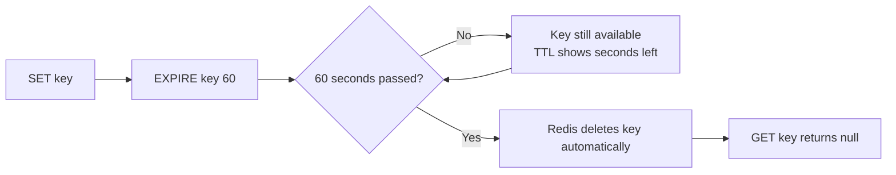
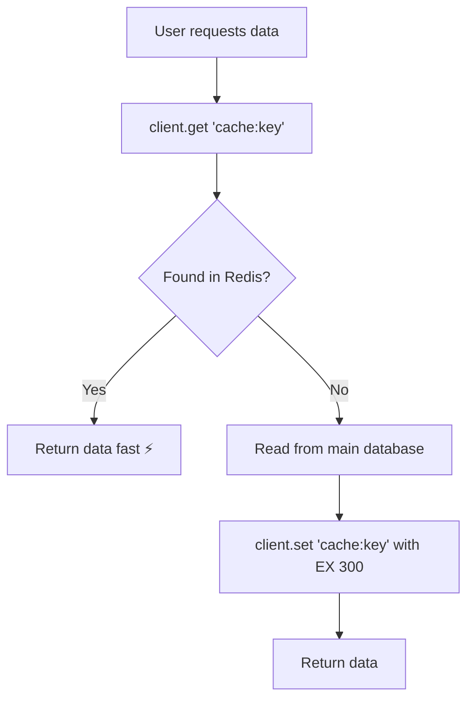
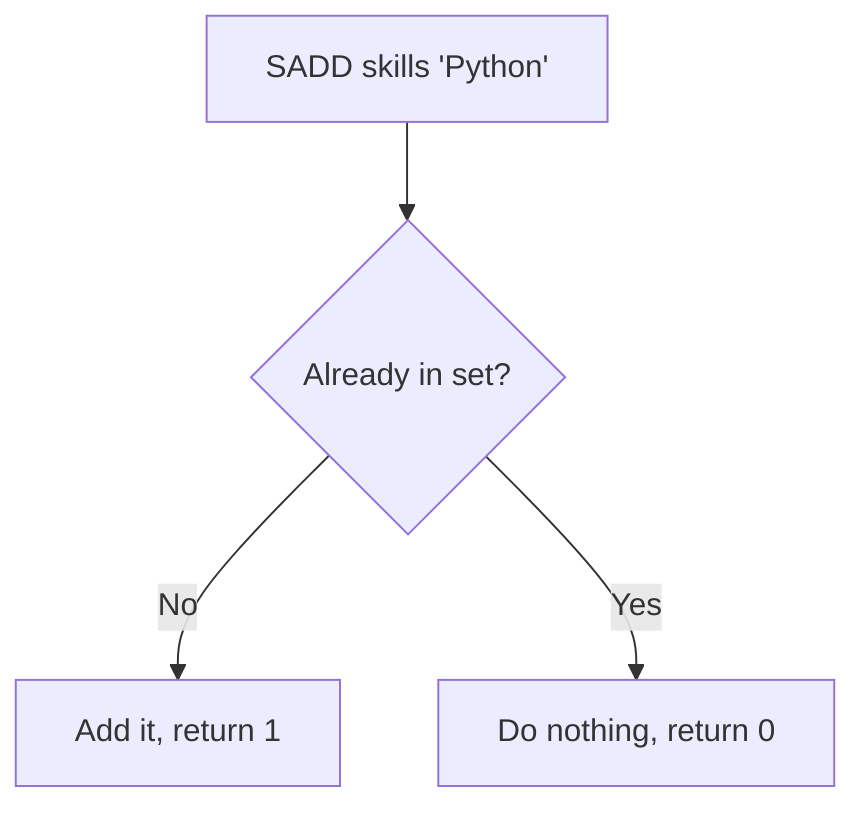
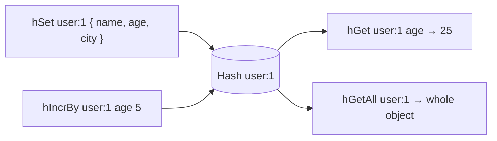
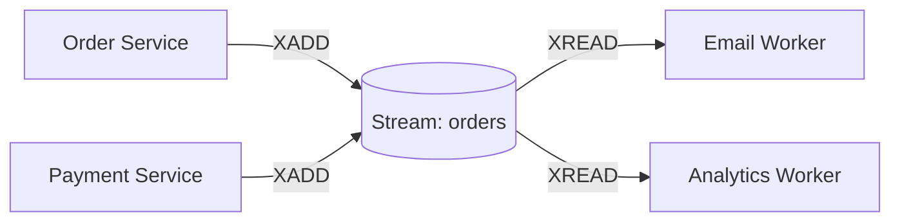
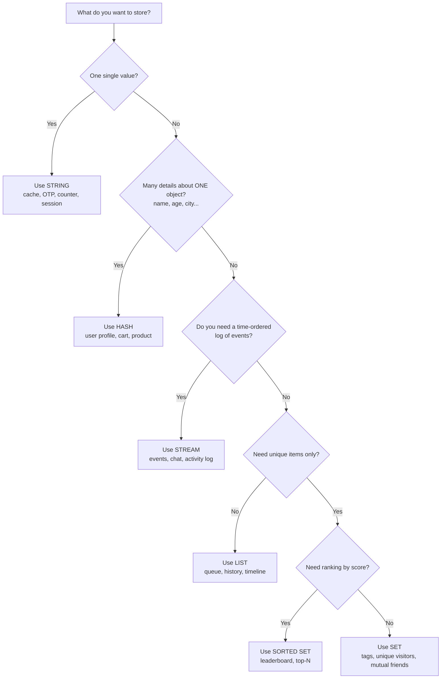

# Redis Data Types: A Simple, In-Depth Guide

> This guide keeps everything from your original notes (all commands, all code) and adds simple explanations, real-world examples, diagrams, and flowcharts.
> Code uses the **Node.js `redis` package (node-redis v4+)**, the same style as your file.

---

## Table of Contents

1. [What is Redis?](#1-what-is-redis)
2. [Setup (your `redisConnection.js`)](#2-setup)
3. [General Purpose Commands](#3-general-purpose-commands)
4. [Overview of the 6 Data Types](#4-overview-of-the-6-data-types)
5. [String](#5-string)
6. [List](#6-list)
7. [Set](#7-set)
8. [Sorted Set](#8-sorted-set)
9. [Hash](#9-hash)
10. [Stream](#10-stream)
11. [Side-by-Side Comparison](#11-side-by-side-comparison)
12. [Which Data Type Should I Use? (Flowchart)](#12-which-data-type-should-i-use)
13. [Common Mistakes](#13-common-mistakes)
14. [Practice Exercises](#14-practice-exercises)

---

## 1. What is Redis?

**Redis** = **RE**mote **DI**ctionary **S**erver.

It is a very fast database that keeps data **in memory (RAM)**. Because RAM is much faster than a hard disk, Redis can answer in less than a millisecond.

**Real-world example:** Think of a restaurant.

- The **main database** (MongoDB / MySQL) is the big **storeroom** at the back. It has everything, but it takes time to go there.
- **Redis** is the **small table next to the chef** with the things used most often. It is quick to reach.

```
 User ──► Your App ──► Redis (fast, in RAM) ──► found? return it ✅
                           │
                           └─► not found? ──► Main Database (slower)
                                                  │
                                    save a copy in Redis ◄──┘
```

Redis stores data as **key → value** pairs. The **value** can be one of several **data types**, and that is what this guide is about.

```
 KEY              VALUE (with a type)
 ─────────────    ─────────────────────────────
 "name"       ──► "Sara"                    (String)
 "skills"     ──► ["JS", "Python"]          (List)
 "tags"       ──► {"a", "b", "c"}           (Set)
 "scores"     ──► {vinay:1, punit:2}        (Sorted Set)
 "user:1"     ──► {name:"vikash", age:20}   (Hash)
 "events"     ──► entries with IDs          (Stream)
```

---

## 2. Setup

Your file imports `client` from `./redisConnection.js`. A typical version of that file looks like this:

```js
// redisConnection.js
import { createClient } from "redis";

export const client = createClient({
  url: "redis://localhost:6379", // default Redis address
});

client.on("error", (err) => console.log("Redis Client Error", err));

await client.connect(); // connect before using any command
```

Then in your learning file:

```js
import { client } from "./redisConnection.js";

await client.set("hello", "world");
console.log(await client.get("hello")); // world
```

> **Tip:** Because the code uses `await` at the top level, your `package.json` needs `"type": "module"`.

---

## 3. General Purpose Commands

These commands work on **any** key, no matter which data type it holds.

| #   | Command  | What it does                                          | Example            |
| --- | -------- | ----------------------------------------------------- | ------------------ |
| 1   | `KEYS`   | Get all keys that match a pattern                     | `KEYS user:*`      |
| 2   | `EXISTS` | Check if a key exists (1 = yes, 0 = no)               | `EXISTS user:1`    |
| 3   | `DEL`    | Delete a key                                          | `DEL user:1`       |
| 4   | `EXPIRE` | Set a timeout on a key (in seconds)                   | `EXPIRE otp:99 60` |
| 5   | `TTL`    | Show how many seconds are left before the key expires | `TTL user:1`       |

### Real-world example: OTP that expires in 60 seconds

```js
await client.set("otp:9876543210", "482913"); // save OTP
await client.expire("otp:9876543210", 60); // delete after 60 seconds

console.log(await client.ttl("otp:9876543210")); // e.g. 58  (seconds left)

// ... after 60 seconds ...
console.log(await client.get("otp:9876543210")); // null  (key is gone)
```

### Code for every general command

```js
// KEYS: find all keys matching a pattern
const keys = await client.keys("user:*");
console.log(keys); // ['user:1', 'user:2']

// EXISTS: 1 if the key exists, 0 if not
console.log(await client.exists("user:1")); // 1

// DEL: delete one key or many keys
await client.del("user:1");
await client.del(["name", "age"]);

// EXPIRE: set a timeout
await client.expire("age", 60);

// TTL: remaining time
console.log(await client.ttl("age"));
```

### What does `TTL` return?

| Return value               | Meaning                                                    |
| -------------------------- | ---------------------------------------------------------- |
| `58` (any positive number) | 58 seconds are left                                        |
| `-1`                       | Key exists but has **no expiry** (it lives forever)        |
| `-2`                       | Key **does not exist** (never created, or already expired) |

### Key expiry flow



> ⚠️ **Warning about `KEYS`:** It scans **every** key in the database. On a big production database this can freeze Redis. Use it for learning and testing only. In real projects use `SCAN`, which reads keys in small batches.

---

## 4. Overview of the 6 Data Types

```
                         ┌───────────────────┐
                         │   REDIS DATA TYPES │
                         └─────────┬─────────┘
   ┌───────────┬───────────┬──────┴─────┬────────────┬───────────┐
   ▼           ▼           ▼            ▼            ▼           ▼
 String      List         Set       Sorted Set      Hash       Stream
 (one        (ordered,   (unique,   (unique,       (field →    (log of
  value)      can repeat) no order)  ordered by     value       events)
                                     score)         pairs)
```

| #   | Data Type      | One-line idea                                | Real-world picture                      |
| --- | -------------- | -------------------------------------------- | --------------------------------------- |
| 1   | **String**     | One simple value                             | A sticky note with one thing written    |
| 2   | **List**       | Ordered items, duplicates OK                 | A queue of people at a ticket counter   |
| 3   | **Set**        | Unique items, no order                       | A bag of unique stickers                |
| 4   | **Sorted Set** | Unique items, ordered by score               | A leaderboard in a game                 |
| 5   | **Hash**       | Many fields about one thing                  | A student ID card (name, roll no, city) |
| 6   | **Stream**     | A log where new entries are added at the end | A CCTV or bank passbook record          |

---

## 5. String

**String is the most basic data type in Redis.**

A String holds **one value**. That value can be text (`"Sara"`), a number (`105`), or even a small JSON text or image bytes (up to 512 MB).

**Real-world picture:** A sticky note on a fridge: `Milk expires: 15 Oct`.

```
 KEY                 VALUE
 ┌──────────────┐    ┌──────────┐
 │ user:name:123│ ─► │  "Sara"  │
 └──────────────┘    └──────────┘
```

### Commands

| Command  | Meaning                     | Example                        |
| -------- | --------------------------- | ------------------------------ |
| `SET`    | Save a value                | `SET user:name:123 "Sara"`     |
| `MSET`   | Multiple SET in one call    | `MSET name "nagrani" age "25"` |
| `GET`    | Read a value                | `GET user:name:123`            |
| `MGET`   | Read multiple values        | `MGET name age`                |
| `DEL`    | Delete a key                | `DEL user:name:123`            |
| `EXPIRE` | Auto delete after N seconds | `EXPIRE age 60`                |
| `TTL`    | Time left (seconds)         | `TTL age`                      |

### Code (from your file)

```js
// SET: store one value
await client.set("name", "Sara");

// SET with options: EX = expire in seconds
await client.set("age", 105, {
  // EX: 60, // Expire in 60 seconds
});

// MSET: set multiple keys at once
await client.mSet({ name: "nagrani", age: "25" });

// DEL: delete one key, or many keys
await client.del("name");
await client.del(["name", "age"]);

// GET: read one key
const result = await client.get("name");

// MGET: read many keys, returns an array
const results = await client.mGet(["name", "age"]);

// EXPIRE and TTL
await client.expire("age", 60); // expire in 60 seconds
console.log(await client.ttl("age")); // time to live of the key in seconds
```

### Real-world example 1: Cache a page for 5 minutes

```js
// Save the result of a slow database query for 300 seconds
await client.set("cache:homepage", "<html>...</html>", { EX: 300 });

const page = await client.get("cache:homepage");
if (page) {
  console.log("Served from Redis (fast!)");
} else {
  console.log("Cache expired, fetch from database again");
}
```

### Real-world example 2: Page-visit counter

Strings that hold numbers can be increased with `INCR`. It is **atomic**, so even if 1000 users arrive at the same time, no count is lost.

```js
await client.incr("page:views"); // 1
await client.incr("page:views"); // 2
await client.incrBy("page:views", 10); // 12
console.log(await client.get("page:views")); // "12"
```

### Real-world example 3: Login session

```js
await client.set("session:abc123", "user:42", { EX: 3600 }); // 1 hour login
```

### Cache flow with String



> **Note:** Redis always stores Strings. Even if you `set('age', 105)`, `get('age')` returns the text `"105"`.

---

## 6. List

**List is the second data type in Redis.**

It is an **ordered collection of strings** (like an array). **Duplicate values are allowed.** You can add elements at the **head (left)** or the **tail (right)**.

Example: `Skills: ["JavaScript", "Python", "Java", "C++"]`

**Real-world picture:** A queue at a ticket counter. People join at the back and are served from the front.

```
  Left (head)                                         Right (tail)
     ▼                                                      ▼
  ┌────────────┬──────────┬────────┬───────┐
  │ JavaScript │  Python  │  Java  │  C++  │
  └────────────┴──────────┴────────┴───────┘
  index: 0          1          2        3
  (also:  -4        -3         -2       -1)
```

> Redis allows **negative indexes**: `-1` is the last element, `-2` is the second last, and so on.

### Commands

| #   | Command                     | Meaning                                                                    |
| --- | --------------------------- | -------------------------------------------------------------------------- |
| 1   | `LPUSH` (Left push)         | Add element to the **left (head)**                                         |
| 2   | `RPUSH` (Right push)        | Add element to the **right (tail)**                                        |
| 3   | `LPOP` (Left pop)           | Remove (and return) element from the **left**                              |
| 4   | `RPOP` (Right pop)          | Remove (and return) element from the **right**                             |
| 5   | `LRANGE`                    | Get elements of the list in a range                                        |
| 6   | `LRANGE listName start end` | `LRANGE skills 0 -1` gets **all** elements                                 |
| 7   | `LLEN`                      | Get the length of the list                                                 |
| 8   | `LINDEX listName index`     | Get the element at a position, e.g. `LINDEX skills 0` is the first element |

### How LPUSH and RPUSH work (step by step)

```
Start:                         []

LPUSH 'javascript'             ['javascript']

LPUSH 'python'                 ['python', 'javascript']      ← added on the LEFT

RPUSH 'java'                   ['python', 'javascript', 'java']   ← added on the RIGHT
```

This is exactly the example from your notes:

```
['javascript']
1) LPUSH (Left push)  → ["python", "javascript"]
2) RPUSH (Right push) → ["javascript", "python"]
```

### How LPOP and RPOP work

```
List:  ['python', 'javascript', 'java']

LPOP  → removes 'python'   → List: ['javascript', 'java']
RPOP  → removes 'java'     → List: ['javascript']
```

### Code (from your file)

```js
await client.lPush("TechSkills", "nodejs");
await client.lPush("TechSkills", "python");
await client.rPush("TechSkills", "java");
await client.lPop("TechSkills");
await client.del("TechSkills");

const Liskills = await client.lPush("TechSkills", [
  "JavaScript",
  "Node.js",
  "Redis",
  "MongoDB",
]);

const getSkills = await client.lRange("TechSkills", 0, -1); // get all the elements of the list
const listLength = await client.lLen("TechSkills"); // get the length of the list

console.log(getSkills);
console.log(listLength);

// lIndex: get one element by position
const first = await client.lIndex("TechSkills", 0);
```

> 🧠 **Important surprise:** When you give `lPush` an array, each item is pushed to the left **one by one**. So the final order is **reversed**:
>
> ```js
> await client.lPush("TechSkills", [
>   "JavaScript",
>   "Node.js",
>   "Redis",
>   "MongoDB",
> ]);
> console.log(await client.lRange("TechSkills", 0, -1));
> // ['MongoDB', 'Redis', 'Node.js', 'JavaScript']
> ```
>
> If you want the same order as your array, use `rPush` instead.

### Real-world example 1: Task queue (first come, first served)

```js
// Producer: add jobs to the end of the queue
await client.rPush("jobs", "send-email-1");
await client.rPush("jobs", "send-email-2");
await client.rPush("jobs", "resize-image-7");

// Worker: take the oldest job from the front
const job = await client.lPop("jobs");
console.log(job); // 'send-email-1'
```

```
 RPUSH → [ job1 | job2 | job3 ] ← back of queue
                ▲
 LPOP ──────────┘  (take from front)
```

### Real-world example 2: "Last 5 things the user viewed"

```js
await client.lPush("recent:user:1", "product:10");
await client.lPush("recent:user:1", "product:25");
await client.lPush("recent:user:1", "product:7");

await client.lTrim("recent:user:1", 0, 4); // keep only 5 newest
console.log(await client.lRange("recent:user:1", 0, -1)); // ['product:7','product:25','product:10']
```

### Using List as a Stack or a Queue

```
 QUEUE (FIFO: first in, first out)     STACK (LIFO: last in, first out)
 RPUSH to add, LPOP to remove          LPUSH to add, LPOP to remove
```

> **Remember:** Reading by position at the **ends** is very fast. Reading from the **middle** of a very long list is slow, because Redis has to walk through the elements.

---

## 7. Set

**Set is the third data type in Redis.**

It is an **unordered collection of unique strings**. **Duplicate values are not allowed.**

Example: `Skills: ["JavaScript", "Python", "Java", "C++"]`

**Real-world picture:** A bag of unique stickers. If you try to put the same sticker in again, nothing changes. And the stickers in the bag have no fixed order.

```
   ┌─────────────── SET: skills ────────────────┐
   │                                            │
   │    JavaScript      Python       Java       │   ← no order, no duplicates
   │            Node.js        MongoDB          │
   └────────────────────────────────────────────┘

   SADD skills "Python"   → returns 0 (already there, nothing added)
```

### Key points (from your notes)

- Duplicate values **not allowed**
- Order is **not fixed**
- Set is generally fast for checking "is this item in the set?". A Set uses a **hash table** to store elements, so checking membership takes constant time, no matter how big the set is. In a List, Redis may have to walk through the elements one by one.

### Difference between List and Set

| Point                 | List                           | Set                                 |
| --------------------- | ------------------------------ | ----------------------------------- |
| Order                 | Ordered                        | Unordered                           |
| Duplicates            | Allowed                        | Not allowed                         |
| Stored using          | Linked list / compact list     | Hash table (or small integer array) |
| Check "does X exist?" | Slow (may check every element) | Fast                                |
| Best for              | Queues, history, timelines     | Unique items, tags, relations       |

> 📝 **Small correction to your notes:** Your notes say "a List is slower because it has to maintain the order". The real reason is simpler: to check if a value exists in a List, Redis must look through the elements one by one. A Set can jump straight to the item using a hash table.

### Commands

| #   | Command     | Meaning                                                                           |
| --- | ----------- | --------------------------------------------------------------------------------- |
| 1   | `SADD`      | Add element(s) to the set                                                         |
| 2   | `SREM`      | Remove element(s) from the set                                                    |
| 3   | `SMEMBERS`  | Get all elements of the set                                                       |
| 4   | `SISMEMBER` | Check if an element exists in the set                                             |
| 5   | `SINTER`    | Intersection of sets, meaning the **common** elements. Syntax: `SINTER set1 set2` |
| 6   | `SCARD`     | Get the number of elements in the set                                             |

### Code (from your file)

```js
await client.sAdd("skills", "JavaScript");
await client.sAdd("skills", "Python");
await client.sAdd("skills", "Java");
await client.sAdd("skills", ["Node.js", "Redis", "MongoDB"]); // add multiple elements at once

const removedElement = await client.sRem("skills", "Redis"); // remove element from the set
console.log(removedElement); // 1 (number of elements removed)

const getSkills = await client.sMembers("skills"); // get all the elements of the set
console.log("Getting all skills", getSkills);

const isMember = await client.sIsMember("skills", "Python"); // check if an element exists
console.log("checking is exists", isMember); // true

// SCARD: count the elements
console.log(await client.sCard("skills"));
```

### SINTER: finding common elements (Venn diagram)

```
        Set A: vinay's skills            Set B: punit's skills
     ┌────────────────────────┐      ┌────────────────────────┐
     │  Java      ┌───────────┼──────┼───────────┐   Go       │
     │            │ JavaScript│      │           │            │
     │  C++       │  Python   │ ←common→          │   Rust     │
     │            └───────────┼──────┼───────────┘            │
     └────────────────────────┘      └────────────────────────┘

     SINTER A B  →  ['JavaScript', 'Python']
```

```js
await client.sAdd("skills:vinay", ["JavaScript", "Python", "Java", "C++"]);
await client.sAdd("skills:punit", ["JavaScript", "Python", "Go", "Rust"]);

const common = await client.sInter(["skills:vinay", "skills:punit"]);
console.log(common); // ['JavaScript', 'Python']
```

### Real-world example 1: Unique visitors today

If the same user visits 10 times, they are counted only once.

```js
await client.sAdd("visitors:2026-10-12", "user:1");
await client.sAdd("visitors:2026-10-12", "user:2");
await client.sAdd("visitors:2026-10-12", "user:1"); // duplicate, ignored

console.log(await client.sCard("visitors:2026-10-12")); // 2
```

### Real-world example 2: Mutual friends

```js
await client.sAdd("friends:alice", ["bob", "carol", "dave"]);
await client.sAdd("friends:eve", ["carol", "dave", "frank"]);

console.log(await client.sInter(["friends:alice", "friends:eve"]));
// ['carol', 'dave']  ← mutual friends
```

### Real-world example 3: Tags on a blog post

```js
await client.sAdd("post:1:tags", ["redis", "database", "nodejs"]);
console.log(await client.sIsMember("post:1:tags", "redis")); // true
```

### Flow of SADD



---

## 8. Sorted Set

**Sorted Set is the fourth data type in Redis.**

It is an **ordered collection of unique strings**. **Duplicates are not allowed.** Every element has a **score**, and the score decides the order.

**Real-world picture:** A **game leaderboard** or **exam rank list**. Each player (unique name) has a score, and the list is always sorted by score.

```
  SORTED SET: students          (sorted from small score to large score)

   rank 0        rank 1        rank 2
 ┌─────────┐   ┌─────────┐   ┌─────────┐
 │ vinay   │   │ punit   │   │ karan   │
 │ score:1 │   │ score:2 │   │ score:3 │
 └─────────┘   └─────────┘   └─────────┘
  ◄── ZRANGE (small → large)
  ZREVRANGE / REV (large → small) ──►
```

### Key points (from your notes)

- Duplicate values are **not allowed** (the same _member_ can't be added twice; adding it again just **updates its score**)
- Order is fixed based on the **score**
- Internally, a Sorted Set uses a **skip list** (plus a hash table) so it can keep elements sorted and still find, add, or remove them quickly (`O(log N)`)

### Difference between Set and Sorted Set

| Point             | Set                             | Sorted Set                              |
| ----------------- | ------------------------------- | --------------------------------------- |
| Order             | Unordered                       | Ordered by score                        |
| Score per element | No                              | Yes                                     |
| Duplicates        | Not allowed                     | Not allowed                             |
| Best for          | Unique items, membership checks | Leaderboards, rankings, priority queues |

> 📝 **Small correction to your notes:** Your notes say a Sorted Set is "faster than List and Set". That is not exactly true. A Sorted Set does extra work to keep the elements sorted, so adding is a bit slower (`O(log N)`) than a plain Set (`O(1)`). Its big advantage is not speed but **automatic sorting**: you get ranked results without sorting anything yourself.

### Commands

| #   | Command     | Meaning                                                                            |
| --- | ----------- | ---------------------------------------------------------------------------------- |
| 1   | `ZADD`      | Add element(s) with a score                                                        |
| 2   | `ZREM`      | Remove an element                                                                  |
| 3   | `ZRANGE`    | Get elements from **smaller to larger** score                                      |
| 4   | `ZREVRANGE` | Get elements from **larger to smaller** score                                      |
| 5   | `ZRANK`     | Position (rank) of an element, counting from smaller to larger score (starts at 0) |
| 6   | `ZSCORE`    | Get the score of an element                                                        |
| 7   | `ZCARD`     | Get the number of elements                                                         |

### Code (from your file)

```js
await client.zAdd("students", { score: 1, value: "vinay" });
await client.zAdd("students", [
  { score: 2, value: "punit" },
  { score: 3, value: "karan" },
]);

const getStudents = await client.zRange("students", 0, -1); // small → large
console.log("Getting all students in ascending order", getStudents);
// ['vinay', 'punit', 'karan']

const getStudentsReverse = await client.zRange("students", 0, -1, {
  REV: true,
}); // large → small
console.log("Getting all students in descending order", getStudentsReverse);
// ['karan', 'punit', 'vinay']

const getScore = await client.zScore("students", "vinay"); // score of an element
console.log("Getting score of vinay", getScore); // 1

const getRank = await client.zRank("students", "karan"); // rank of an element
console.log("Getting rank of karan", getRank); // 2

console.log(await client.zCard("students")); // 3

// ZREM: remove an element
await client.zRem("students", "punit");
```

### Real-world example 1: Game leaderboard (Top 3 players)

```js
await client.zAdd("leaderboard", [
  { score: 1500, value: "Aman" },
  { score: 2300, value: "Riya" },
  { score: 1800, value: "Karan" },
  { score: 900, value: "Neha" },
]);

// Top 3 players: highest score first
const top3 = await client.zRangeWithScores("leaderboard", 0, 2, { REV: true });
console.log(top3);
// [ {value:'Riya', score:2300}, {value:'Karan', score:1800}, {value:'Aman', score:1500} ]

// Aman just scored 1000 more points. Re-adding the same member UPDATES the score
await client.zIncrBy("leaderboard", 1000, "Aman"); // Aman = 2500, now rank 1!
```

```
 Before:  Neha 900 | Aman 1500 | Karan 1800 | Riya 2300
 After :  Neha 900 | Karan 1800 | Riya 2300 | Aman 2500   (auto re-sorted!)
```

### Real-world example 2: Scheduled tasks (score = time)

```js
// score = Unix time when the task should run
await client.zAdd("scheduled", {
  score: 1760270400,
  value: "send-reminder-email",
});
await client.zAdd("scheduled", { score: 1760274000, value: "generate-report" });
// The earliest task always comes first in ZRANGE
```

### Understanding rank vs score

```
 Member   Score   Rank (ZRANK, small→large)   Rank (reverse, large→small)
 vinay      1            0                              2
 punit      2            1                              1
 karan      3            2                              0
```

---

## 9. Hash

**Hash is the fifth data type in Redis.**

It is an **unordered collection of key-value pairs** (called **field → value**). **Duplicate fields are not allowed.**

**Real-world picture:** A **student ID card**. One card (the hash) holds many details (fields): name, roll number, age, city.

```
 Example:
 User: {
   name: "Sara",
   age: 25,
   city: "New York"
 }
```

```
   KEY: user:1
   ┌──────────────────────────────────┐
   │  FIELD     │   VALUE             │
   ├────────────┼─────────────────────┤
   │  name      │   vikash            │
   │  RollNo    │   1240150023        │
   │  age       │   20                │
   │  city      │   Lucknow           │
   └──────────────────────────────────┘
```

### Key points (from your notes)

- Duplicate fields are **not allowed**
- Order is **not fixed**
- Hash stores its fields in a **hash table**, so reading or writing one field is very fast.

### Why use a Hash instead of many Strings?

```
 ❌ Using Strings (messy, many keys)        ✅ Using a Hash (clean, one key)
 user:1:name  = "vikash"                    user:1 → { name, age, city }
 user:1:age   = "20"
 user:1:city  = "Lucknow"
```

With a Hash you can read the whole user in **one** command (`HGETALL`) and update **one field** without touching the others.

### Commands

| #   | Command   | Meaning                                                                               |
| --- | --------- | ------------------------------------------------------------------------------------- |
| 1   | `HSET`    | Add field-value pair(s) to the hash                                                   |
| 2   | `HGET`    | Get the value of one field                                                            |
| 3   | `HDEL`    | Remove a field                                                                        |
| 4   | `HGETALL` | Get all fields and values                                                             |
| 5   | `HEXISTS` | Check if a field exists                                                               |
| 6   | `HLEN`    | Get the number of fields                                                              |
| 7   | `HKEYS`   | Get all field names                                                                   |
| 8   | `HVALS`   | Get all values (written as `HVALUES` in your notes; the real command name is `HVALS`) |
| 9   | `HINCRBY` | Increase a numeric field by a given number                                            |

### Code (from your file)

```js
const user = await client.hSet("user:1", {
  name: "vikash",
  RollNo: 1240150023,
  age: 20,
  city: "Lucknow",
}); // add field-value pairs
console.log("Adding user", user); // 4 (number of NEW fields added)

const getUserAge = await client.hGet("user:1", "age"); // get the value of a field
console.log("Getting user age", getUserAge); // "20"

const getUser = await client.hGetAll("user:1"); // get all field-value pairs
console.log("Getting user", getUser);
// { name: 'vikash', RollNo: '1240150023', age: '20', city: 'Lucknow' }

const isUserExists = await client.hExists("user:1", "age"); // check if a field exists
console.log("Checking if user exists", isUserExists); // true (it checks the FIELD 'age')

const userLength = await client.hLen("user:1"); // number of fields
console.log("Getting user length", userLength); // 4

const userKeys = await client.hKeys("user:1"); // all field names
console.log("Getting user keys", userKeys); // ['name','RollNo','age','city']

const userValues = await client.hVals("user:1"); // all values
console.log("Getting user values", userValues);

const incrementUserAge = await client.hIncrBy("user:1", "age", 5); // increase by 5
console.log("Incrementing user age", incrementUserAge); // 25

const decrementUserAge = await client.hIncrBy("user:1", "age", -5); // decrease by 5
console.log("Decrementing user age", decrementUserAge); // 20

console.log(await client.hDel("user:2", "age")); // delete the 'age' field from the user:2 hash
// returns 1 if the field was deleted, 0 if it did not exist
```

> 💡 In your last line you delete from `user:2`, but the data above was saved in `user:1`. So this returns `0` unless you also created `user:2`. It is not a bug, just something to be aware of while testing.

### Real-world example 1: Shopping cart

Field = product, value = quantity.

```js
await client.hSet("cart:user:1", { shirt: 2, shoes: 1 });
await client.hIncrBy("cart:user:1", "shirt", 1); // add one more shirt → 3
await client.hDel("cart:user:1", "shoes"); // remove shoes from cart
console.log(await client.hGetAll("cart:user:1")); // { shirt: '3' }
```

### Real-world example 2: Product details

```js
await client.hSet("product:101", {
  title: "Wireless Mouse",
  price: 799,
  stock: 25,
});

await client.hIncrBy("product:101", "stock", -1); // one item sold
```

### Hash flow: update one field only



> **Note:** Hash values are **flat**. They can only be strings or numbers, not nested objects. If you have a nested object, flatten it or store it as JSON in a String.

---

## 10. Stream

**Stream is the sixth data type in Redis.** (It is listed in your notes, but the notes did not cover it yet, so here is a beginner-friendly introduction.)

A Stream is like a **log book**. New entries are only **added at the end**, and every entry gets a unique **ID** (based on time) and holds **field-value pairs**.

**Real-world picture:** A **CCTV recording** or a **bank passbook**. Every event is written one after another, and old entries stay there so you can read them later.

```
  STREAM: orders
  ┌──────────────────┬──────────────────────────────┐
  │ ID               │ DATA                         │
  ├──────────────────┼──────────────────────────────┤
  │ 1760270400000-0  │ { item: "shirt", qty: 2 }    │   ← oldest
  │ 1760270401500-0  │ { item: "shoes", qty: 1 }    │
  │ 1760270409000-0  │ { item: "cap",   qty: 3 }    │   ← newest (added at the end)
  └──────────────────┴──────────────────────────────┘
```

### Commands

| Command  | Meaning                                                    |
| -------- | ---------------------------------------------------------- |
| `XADD`   | Add a new entry to the stream (`*` = auto-generate the ID) |
| `XRANGE` | Read entries between two IDs (`-` = start, `+` = end)      |
| `XLEN`   | Number of entries in the stream                            |
| `XREAD`  | Read new entries (can wait for new ones)                   |

### Code

```js
// XADD: add entries ('*' means Redis creates the ID)
await client.xAdd("orders", "*", { item: "shirt", qty: "2" });
await client.xAdd("orders", "*", { item: "shoes", qty: "1" });

// XLEN: how many entries?
console.log(await client.xLen("orders")); // 2

// XRANGE: read all entries ('-' = smallest ID, '+' = biggest ID)
const all = await client.xRange("orders", "-", "+");
console.log(all);
// [
//   { id: '1760270400000-0', message: { item: 'shirt', qty: '2' } },
//   { id: '1760270401500-0', message: { item: 'shoes', qty: '1' } }
// ]
```

### Stream vs List

| Point                          | List                | Stream                                    |
| ------------------------------ | ------------------- | ----------------------------------------- |
| After reading with `LPOP`      | Item is **removed** | Entry **stays** (you can read it again)   |
| Entry shape                    | A single string     | Several field-value pairs                 |
| Entry ID                       | No                  | Yes (time-based)                          |
| Many readers (consumer groups) | No                  | Yes                                       |
| Best for                       | Simple queues       | Event logs, chat messages, activity feeds |

### Producer / Consumer flow



---

## 11. Side-by-Side Comparison

| Feature            |       String        |        List         |          Set           |     Sorted Set      |        Hash        |       Stream       |
| ------------------ | :-----------------: | :-----------------: | :--------------------: | :-----------------: | :----------------: | :----------------: |
| Holds              |       1 value       |     many values     |      many values       | many values + score | field-value pairs  |    log entries     |
| Ordered?           |         n/a         | ✅ insertion order  |           ❌           |     ✅ by score     |         ❌         |   ✅ by time/ID    |
| Duplicates?        |         n/a         |     ✅ allowed      |           ❌           |         ❌          |    ❌ (fields)     | ✅ (different IDs) |
| Real-world picture |     Sticky note     |        Queue        | Bag of unique stickers |     Leaderboard     |      ID card       |   Passbook / log   |
| Example use        | Cache, OTP, counter | Task queue, history | Unique visitors, tags  |      Rankings       | User profile, cart |    Events, chat    |
| Add command        |        `SET`        |  `LPUSH` / `RPUSH`  |         `SADD`         |       `ZADD`        |       `HSET`       |       `XADD`       |
| Read command       |        `GET`        |      `LRANGE`       |       `SMEMBERS`       |      `ZRANGE`       |     `HGETALL`      |      `XRANGE`      |
| Count command      |         n/a         |       `LLEN`        |        `SCARD`         |       `ZCARD`       |       `HLEN`       |       `XLEN`       |
| Remove command     |        `DEL`        |   `LPOP` / `RPOP`   |         `SREM`         |       `ZREM`        |       `HDEL`       |       `XDEL`       |

### Command prefix trick

Each command starts with a letter that tells you its data type:

```
 (none)  → String   : SET, GET, MSET, MGET
 L       → List     : LPUSH, RPUSH, LPOP, RPOP, LRANGE, LLEN, LINDEX
 S       → Set      : SADD, SREM, SMEMBERS, SISMEMBER, SINTER, SCARD
 Z       → Sorted Set: ZADD, ZREM, ZRANGE, ZRANK, ZSCORE, ZCARD
 H       → Hash     : HSET, HGET, HDEL, HGETALL, HEXISTS, HLEN, HKEYS, HVALS, HINCRBY
 X       → Stream   : XADD, XRANGE, XLEN, XREAD
```

In node-redis the same command is written in camelCase: `LPUSH` → `lPush`, `HGETALL` → `hGetAll`, `ZADD` → `zAdd`.

---

## 12. Which Data Type Should I Use?



### Quick real-world cheat sheet

| I want to build...                | Use                       |
| --------------------------------- | ------------------------- |
| Login session / OTP               | String + `EXPIRE`         |
| Page view counter                 | String + `INCR`           |
| User profile                      | Hash                      |
| Shopping cart                     | Hash                      |
| Background job queue              | List                      |
| "Recently viewed" items           | List + `LTRIM`            |
| Unique visitors per day           | Set                       |
| Mutual friends / common interests | Set + `SINTER`            |
| Game leaderboard                  | Sorted Set                |
| Scheduled / delayed tasks         | Sorted Set (score = time) |
| Event log, chat messages          | Stream                    |

---

## 13. Common Mistakes

1. **Using `KEYS *` in production.** It can block Redis. Use `SCAN`.
2. **Forgetting that values come back as strings.** `hGet('user:1','age')` returns `"20"`, not `20`. Convert with `Number(...)`.
3. **Expecting `lPush` with an array to keep the order.** It reverses it. Use `rPush` to keep the order.
4. **Using the wrong command for the type.** Example: calling `get` on a List gives a `WRONGTYPE` error.

   ```js
   await client.lPush("mylist", "a");
   await client.get("mylist"); // ❌ Error: WRONGTYPE Operation against a key holding the wrong kind of value
   ```

5. **Forgetting an expiry on cache keys.** Without `EX` or `EXPIRE`, keys stay forever and use up RAM.
6. **Not using a naming pattern.** Use `type:id:field`, like `user:1:name`, `cart:42`, `session:abc`.
7. **Using `await` without connecting.** Always call `client.connect()` once first.

---

## 14. Practice Exercises

Try these in your own file (use your `client`):

1. **String:** Save `otp:123` as `"4821"` that expires in 30 seconds. Print `ttl` twice, 5 seconds apart.
2. **List:** Make a queue called `jobs` with 3 jobs using `rPush`. Process them one by one with `lPop` until the list is empty.
3. **Set:** Create `skills:a` and `skills:b`. Print the common skills using `sInter`.
4. **Sorted Set:** Add 5 players with scores. Print the top 3 with scores.
5. **Hash:** Create `user:5` with `name`, `age`, `city`. Increase `age` by 1 and print the whole user.
6. **Stream:** Add 3 log entries to `logs` and read them all with `xRange`.

### Final summary diagram

```
                      ┌────────────────────────────────┐
                      │            R E D I S           │
                      └───────────────┬────────────────┘
                                      │
   ┌──────────┬────────────┬──────────┴──┬─────────────┬────────────┐
   │ STRING   │   LIST     │    SET      │ SORTED SET  │   HASH     │  STREAM
   │ "Sara"   │ [a,b,a,c]  │ {a,b,c}     │ {a:1,b:2}   │ {name:..}  │  log
   │ SET/GET  │ LPUSH/LPOP │ SADD/SREM   │ ZADD/ZRANGE │ HSET/HGET  │  XADD/XRANGE
   └──────────┴────────────┴─────────────┴─────────────┴────────────┘
```

Happy learning! 🚀
